<div align="center">


# LivWay · Catálogo comercial

**Do fabricante internacional ao importador brasileiro.**

Site institucional, vitrine de produtos e portal de catálogo para clientes de uma trading de importação.<br>
Em produção, projetado, desenvolvido, publicado e mantido por mim, do zero, de ponta a ponta.

[](https://livwaytrading.com)
[](https://nodejs.org)
[](https://expressjs.com)
[](https://developers.cloudflare.com/workers/)
[](https://ejs.co)

**[livwaytrading.com](https://livwaytrading.com)**

<br>

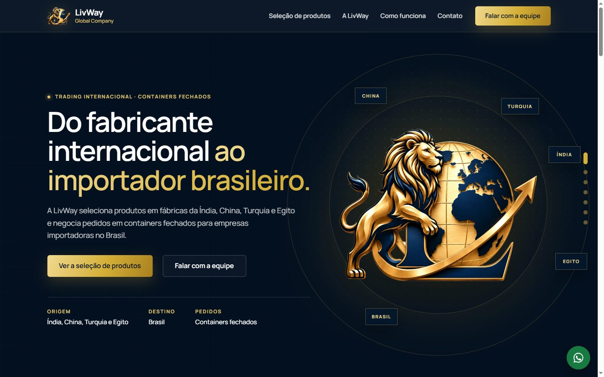

</div>

<br>

## Em resumo

| | |
|---|---|
| **O quê** | Site de vendas, catálogo completo para clientes e painel administrativo, todos sobre o mesmo cadastro |
| **Para quem** | Importadores brasileiros que compram em containers fechados e a equipe comercial da trading |
| **Meu papel** | Tudo: organização do catálogo, design, back-end, front-end, segurança, publicação e manutenção |
| **Stack** | Node.js, Express 5, EJS, HTML/CSS/JS sem framework, Cloudflare Workers, D1, R2, Images e Email Routing |
| **Tamanho** | Mais de 970 produtos e 1.300 fotos organizados a partir de pastas de fornecedores, 2 sites em 2 Workers |
| **Ritmo** | Do primeiro catálogo à versão atual em outubro de 2026, com várias publicações em produção sem perda de dados |

## O problema

A trading tinha milhares de fotos de produtos espalhadas em pastas de fornecedores, sem planilha, sem nomes padronizados e com o mesmo modelo repetido em várias cores. Isso trazia quatro dores:

- **Não havia onde mostrar os produtos** a um importador novo de forma profissional.
- **Clientes atuais pediam o catálogo** e recebiam fotos soltas pelo WhatsApp.
- **Pedidos de cotação chegavam sem padrão**, sem saber exatamente de qual peça e variação o cliente falava.
- **Qualquer mudança no catálogo** dependia de refazer arquivos à mão.

## A solução

Um único código que publica dois sites: uma vitrine para apresentar a empresa a importadores novos e um catálogo completo, fora dos buscadores, para os clientes atuais montarem a seleção e pedirem a cotação. Tudo é mantido por um painel com login, e cada mensagem chega à equipe com o produto, a referência e a variação já identificados.

---

## Sumário

- [Visão geral](#visão-geral)
- [O site principal (vitrine)](#o-site-principal-vitrine)
- [O catálogo para clientes](#o-catálogo-para-clientes)
- [No celular](#no-celular)
- [Funcionalidades](#funcionalidades)
- [Tecnologias](#tecnologias)
- [Arquitetura](#arquitetura)
- [Organização do código](#organização-do-código)
- [Desenvolvimento e publicação](#desenvolvimento-e-publicação)
- [Segurança e privacidade](#segurança-e-privacidade)
- [Princípios do conteúdo](#princípios-do-conteúdo)
- [Decisões técnicas que valem destaque](#decisões-técnicas-que-valem-destaque)
- [Processo de entrega](#processo-de-entrega)
- [Meu papel](#meu-papel)
- [Sobre o código](#sobre-o-código)

<br>

## Visão geral

Um único código serve **dois sites** e **um painel administrativo**, todos lendo o mesmo cadastro de produtos.

| | Para quem | O que faz |
|---|---|---|
| 🦁 **Site principal**<br>`livwaytrading.com` | Importadores que ainda não conhecem a LivWay | Apresenta a empresa, as origens, as linhas de produtos e uma seleção de peças, e leva o visitante a falar com a equipe comercial. |
| 📦 **Catálogo para clientes**<br>subdomínio próprio | Clientes atuais | Catálogo completo com busca, filtros, ficha detalhada e **pedido de cotação** com a seleção de itens. Fora dos buscadores e com senha de acesso opcional. |
| 🛠️ **Painel administrativo** | Equipe LivWay | Produtos, fotos, categorias, vitrine, mensagens, cotações e contatos do site, protegido por login. |

O fluxo comercial é sempre a **conversa com a equipe**: o site não mostra preço, estoque ou condições e não tem pagamento online.

<br>

## O site principal (vitrine)

Página de apresentação com azul-marinho e dourado, tipografia Manrope e efeitos de movimento (luz que segue o mouse, chips flutuando, linhas que se desenham, números que contam ao entrar na tela). Com "reduzir movimento" ligado no aparelho, tudo fica parado.

<table>
  <tr>
    <td width="50%">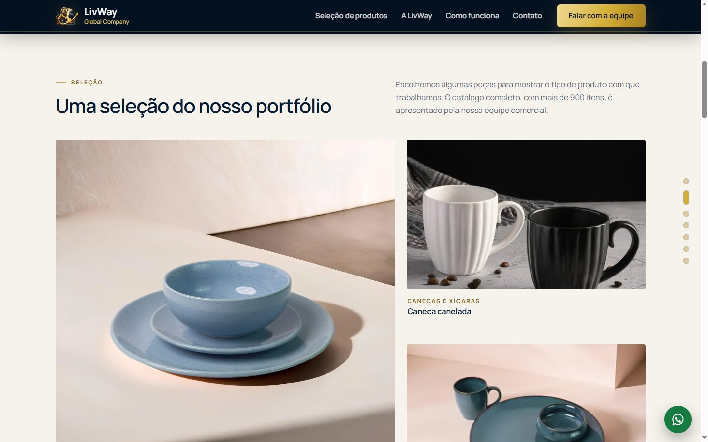</td>
    <td width="50%">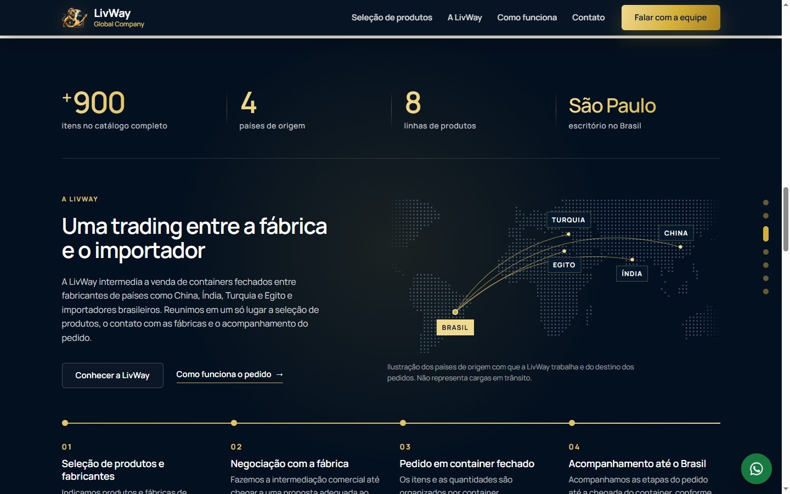</td>
  </tr>
  <tr>
    <td><b>Seleção do portfólio</b><br><sub>Peças escolhidas pelas fotos, sem selos inventados. O catálogo completo é apresentado pela equipe.</sub></td>
    <td><b>A LivWay em números e rotas</b><br><sub>Mapa ilustrativo das origens até o Brasil e as quatro etapas do pedido, que acendem com a rolagem.</sub></td>
  </tr>
  <tr>
    <td>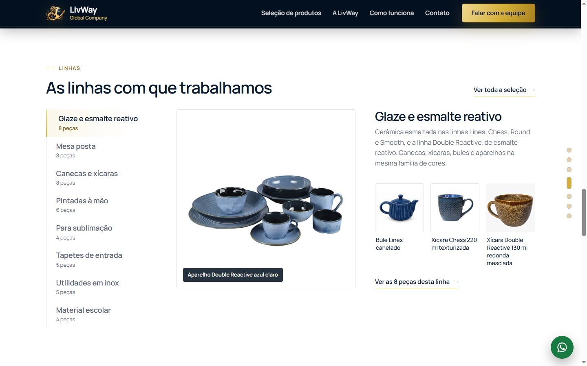</td>
    <td>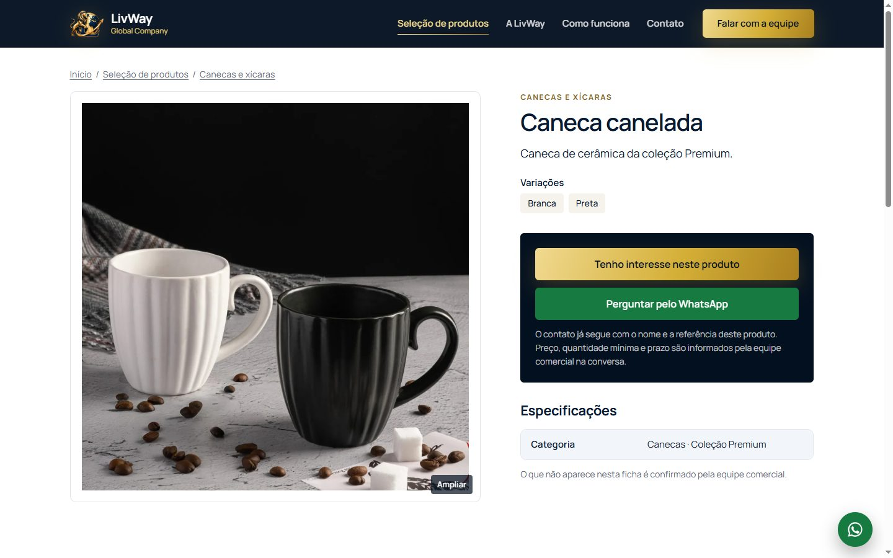</td>
  </tr>
  <tr>
    <td><b>Linhas de produtos</b><br><sub>Lista interativa (mouse, toque ou teclado) com foto grande, texto e três peças de cada linha.</sub></td>
    <td><b>Ficha do produto</b><br><sub>Galeria com ampliação, variações e o botão de interesse, que já leva o produto para o contato.</sub></td>
  </tr>
</table>

<p align="center">
  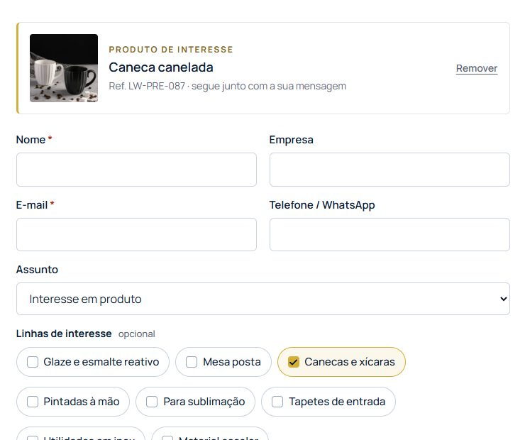<br>
  <sub><b>Contato com contexto</b>: o produto de interesse chega identificado, com linhas de interesse e volume aproximado opcionais.</sub>
</p>

<br>

## O catálogo para clientes

O portal reúne **mais de 900 produtos** em seis categorias (canecas, xícaras, mesa posta e cerâmica, tapetes, utilidades em inox e material escolar). As peças ficam sobre um fundo claro, sem caixas, e o cliente monta uma seleção para pedir a cotação.

<p align="center">
  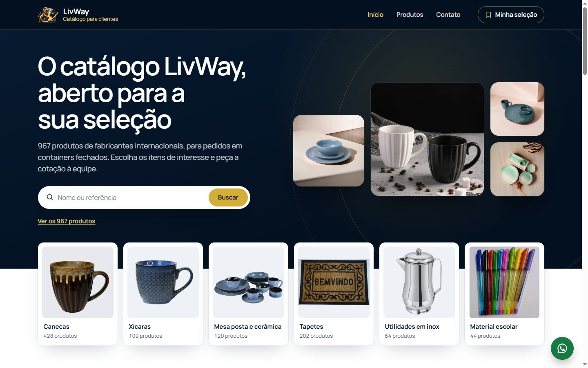
</p>

<table>
  <tr>
    <td width="50%">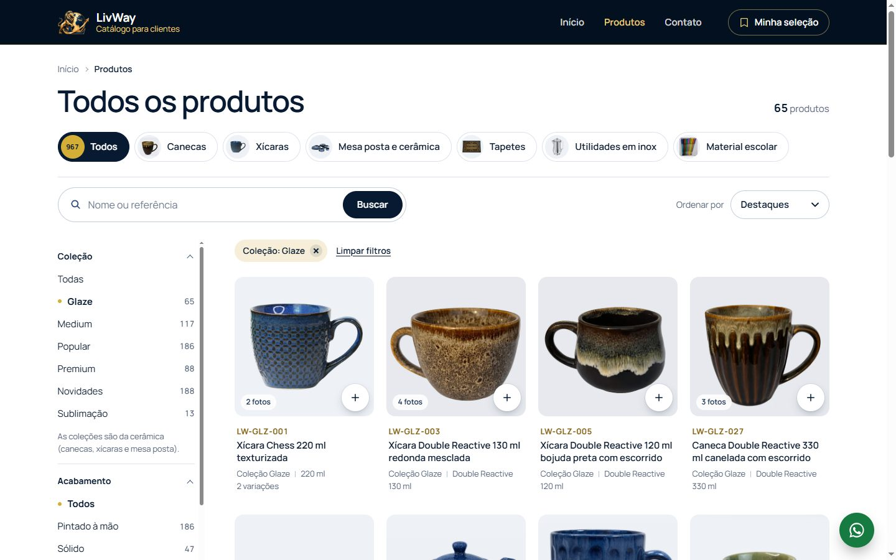</td>
    <td width="50%">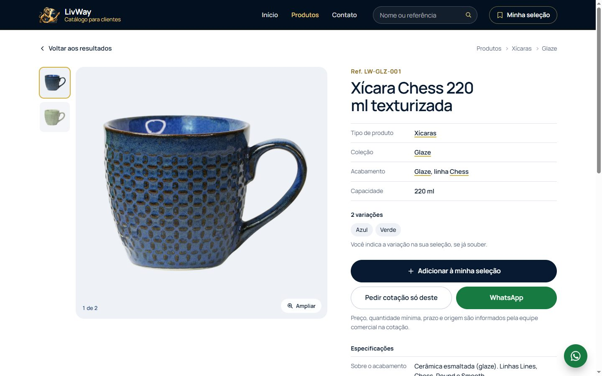</td>
  </tr>
  <tr>
    <td><b>Busca e filtros sem recarregar</b><br><sub>Categoria, coleção, acabamento, linha, cor e capacidade. O endereço muda a cada filtro, então dá para copiar o link e usar o botão voltar.</sub></td>
    <td><b>Ficha e minha seleção</b><br><sub>Referência visível, dados do cadastro com links para a listagem filtrada, variações e o botão "Adicionar à minha seleção".</sub></td>
  </tr>
</table>

<br>

## No celular

Todas as páginas foram pensadas e testadas a 390 px: menu e filtros em gaveta, botões de largura total, barra fixa com a chamada principal e nenhuma rolagem lateral.

<p align="center">
  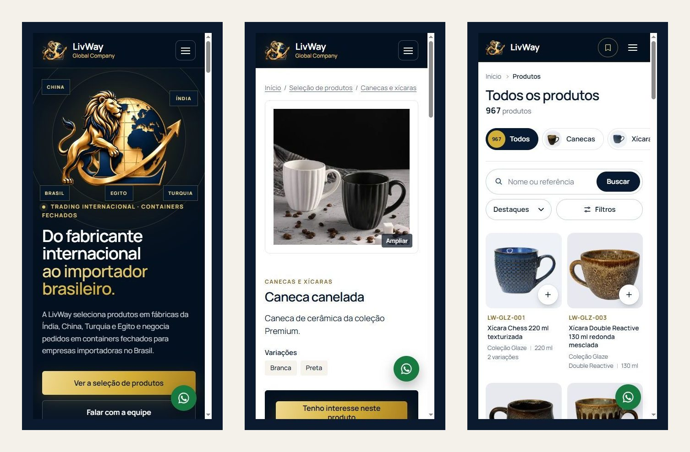
</p>

<br>

## Funcionalidades

<table>
  <tr>
    <td valign="top" width="33%">

**🦁 Site principal**

- Abertura com o símbolo oficial e os países de origem
- Números da empresa calculados do cadastro
- Mapa das rotas e etapas do pedido
- Linhas de produtos interativas
- Vídeos da fábrica com carregamento sob demanda
- Perguntas frequentes
- Ficha de produto com galeria e ampliação
- Contato já preenchido com o produto
- WhatsApp comercial, quando configurado
- SEO: títulos, sitemap, `robots.txt` e dados estruturados

</td>
    <td valign="top" width="33%">

**📦 Catálogo para clientes**

- Busca por nome ou referência, com ou sem traços
- Filtros combináveis sem recarregar a página
- Ordenação e paginação
- "Voltar aos resultados" com filtros e posição
- Minha seleção salva no navegador
- Pedido de cotação com variação, quantidade e observações
- Senha de acesso opcional, lembrada por 30 dias
- `noindex` em todas as páginas

</td>
    <td valign="top" width="33%">

**🛠️ Painel administrativo**

- Produtos: criar, editar, ocultar, excluir
- Fotos: enviar, ordenar, principal, texto alternativo
- Conversão automática para WebP (480 e 1200 px)
- Categorias e subcategorias
- Produtos da vitrine
- Mensagens e cotações com situação e anotações
- Contatos do site e senha do portal
- Troca de senha

</td>
  </tr>
</table>

**Avisos por e-mail:** cada mensagem e cada pedido de cotação é gravado no painel **antes** de qualquer aviso, então nada se perde se o e-mail falhar. Na Cloudflare, o aviso sai pelo Email Routing; no servidor comum, por SMTP.

<br>

## Tecnologias

| Camada | No computador / servidor comum | Na Cloudflare (produção) |
|---|---|---|
| Aplicação | Node.js 20+ · Express 5 | Cloudflare Workers (`nodejs_compat`) com o mesmo Express |
| Páginas | EJS compilado na hora | EJS pré-compilado no build (`scripts/cf-build.js`) |
| Dados | Arquivos JSON em `data/` | Banco **D1** (SQLite) |
| Fotos | Pasta `media/` | Armazenamento **R2** |
| Conversão de fotos | sharp | Cloudflare **Images** |
| E-mail | Nodemailer (SMTP) | **Email Routing** (`send_email`) |
| Segurança | Helmet (CSP), CSRF, sessões assinadas, PBKDF2 | Os mesmos, mais limites no D1 e Turnstile (ao cadastrar as chaves) |
| Front-end | HTML, CSS e JavaScript sem framework · fonte Manrope | |

<br>

## Arquitetura

Rotas, páginas e regras de negócio são as mesmas nas duas plataformas. Só os serviços de dados, fotos e e-mail mudam, e ficam isolados em `src/node/` e `src/cf/`.

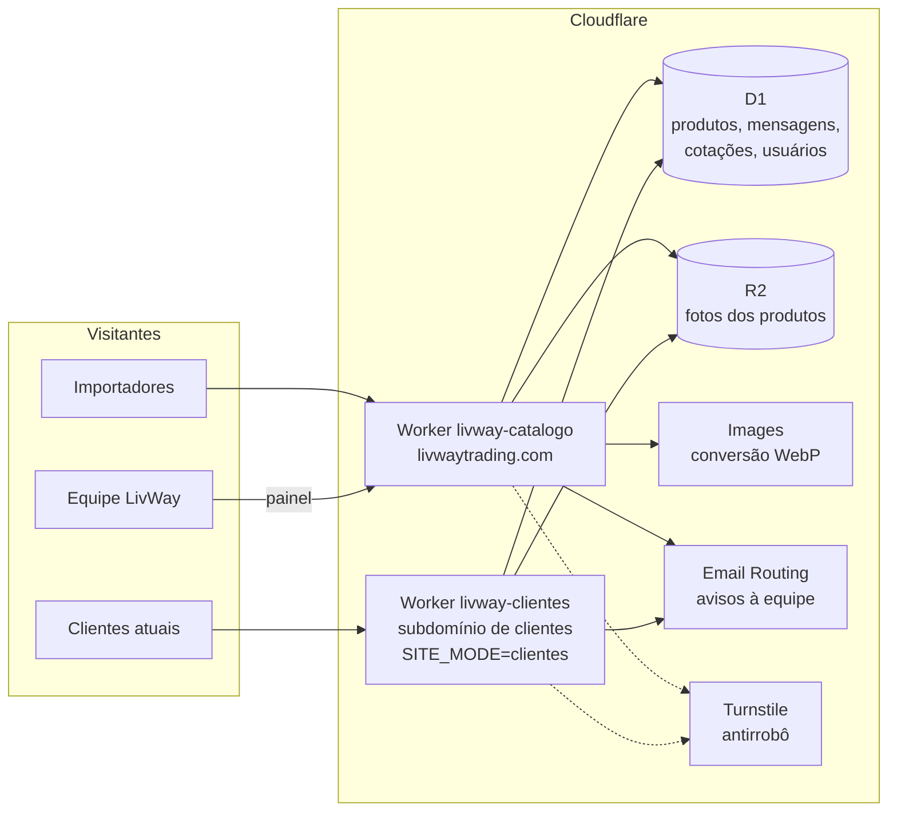

- **Um código, dois Workers.** O site de clientes é o mesmo código publicado com `SITE_MODE=clientes`: sem vitrine, sem painel e com o catálogo na raiz.
- **Um cadastro só.** Os dois sites leem o mesmo banco e as mesmas fotos. Uma alteração feita no painel aparece nos dois em até 15 segundos.
- **Gravar antes de avisar.** Mensagens e cotações são gravadas no banco e só depois geram e-mail.
- **Arquivos com carimbo de versão.** CSS e JavaScript recebem no endereço um carimbo calculado do conteúdo, então o visitante nunca vê página nova com estilo antigo.

<br>

## Organização do código

O código-fonte fica em um repositório privado. Esta é a organização dele:

```text
livway-site/
├── server.js               entrada no computador ou servidor comum
├── worker.mjs              entrada na Cloudflare
├── wrangler.jsonc          configuração dos dois Workers (principal e clientes)
├── src/
│   ├── app.js              o site em Express: segurança, sessões e rotas
│   ├── platform.js         serviços que mudam conforme a plataforma
│   ├── node/               arquivos JSON, sharp e SMTP
│   ├── cf/                 D1, R2, Images e e-mail da Cloudflare
│   ├── routes/             vitrine, catálogo para clientes e painel
│   ├── catalog.js          busca, filtros, ordenação e relacionados
│   ├── showcase.js         seleção e linhas da vitrine
│   ├── security.js         login, CSRF e limite de tentativas
│   └── antibot.js          proteção dos formulários de contato
├── views/                  páginas EJS dos dois sites e do painel
├── public/                 CSS, JavaScript, símbolo, ícones e vídeos
├── cloudflare/migrations/  estrutura do banco D1
├── scripts/                configuração, build e envio à Cloudflare
└── test/                   testes automáticos
```

<br>

## Desenvolvimento e publicação

| Etapa | Como é feito |
|---|---|
| Rodar no computador | `npm start` (site principal) e `npm run dev:clientes` (catálogo para clientes), com os dados em arquivos JSON |
| Simular a Cloudflare | `npm run cf:dev`, com banco D1 e armazenamento R2 locais |
| Testar | `npm test` e roteiros em navegador real (Playwright) a 1440 px e 390 px |
| Publicar | `npm run cf:publicar` e `npm run cf:publicar:clientes`, um Worker para cada site |
| Banco | Migrações versionadas em `cloudflare/migrations/` |
| Segredos | Gravados com `wrangler secret put`, nunca em arquivo |

<br>

## Segurança e privacidade

- Senhas guardadas apenas como hash (PBKDF2-SHA256) e segredo de sessão fora do código.
- Proteção CSRF em todos os formulários e cabeçalhos de segurança com política de conteúdo (CSP).
- Limite de tentativas no login, na senha do portal e nos formulários.
- Formulários de contato protegidos em camadas: campo invisível, validação e limites por IP e por e-mail. A verificação Cloudflare Turnstile, conferida no servidor, já está no código e passa a valer quando as chaves forem cadastradas.
- Os registros de bloqueio guardam só o motivo e um código embaralhado, sem nome, e-mail ou mensagem.
- Produtos ocultos não aparecem para visitantes, e o painel e o catálogo para clientes ficam fora dos buscadores.

<br>

## Princípios do conteúdo

- **Nada inventado.** Preço, origem por produto, material, estoque e certificações só aparecem quando vêm de fonte real. Informação ausente não aparece, nem como zero.
- **Cotação, não compra.** Preço, quantidade mínima, prazo e condições são sempre informados pela equipe comercial.
- **Marcas de terceiros** ficam ocultas até a licença ser confirmada.
- **Identidade visual:** azul-marinho e dourado, símbolo oficial do leão, uma única família tipográfica (Manrope) e contraste conferido pelo critério WCAG AA.

<br>

## Decisões técnicas que valem destaque

- **Um código, duas plataformas**: rotas, páginas e regras são as mesmas no Node e na Cloudflare; só dados, fotos e e-mail mudam, isolados em adaptadores.
- **Um código, dois sites**: o catálogo para clientes é o mesmo código publicado num segundo Worker com outra variável de modo, sem cadastro duplicado.
- **Páginas pré-compiladas**: o Workers não permite gerar código em execução, então os modelos EJS são compilados no build; no computador, o mesmo compilador roda na hora.
- **Gravar antes de avisar**: mensagens e cotações vão para o banco antes do e-mail; se o aviso falhar, nada se perde e o painel mostra o que não saiu.
- **Vazio não é zero**: informação que falta no cadastro não aparece; filtros de cor, capacidade e material avisam quantos produtos têm o dado.
- **Filtros sem recarregar com endereço real**: cada filtro troca só a listagem e atualiza a URL, então o link pode ser copiado e o botão voltar funciona. Sem JavaScript, tudo continua funcionando.
- **Cache com carimbo de conteúdo**: CSS e JavaScript recebem no endereço um hash do arquivo, para nunca misturar página nova com estilo antigo.
- **Antirrobô sem perder contato real**: campo invisível, limites por IP e por e-mail no D1 e Turnstile conferido no servidor, sem bloquear nomes estrangeiros ou domínios incomuns.
- **Movimento com acessibilidade**: todos os efeitos respeitam "reduzir movimento", o toque não recebe efeitos de mouse e o contraste foi medido pelo critério WCAG AA.

## Processo de entrega

- Organização do catálogo a partir das pastas: fotos repetidas descartadas, modelos agrupados com variações de cor e fotos com marcas de terceiros retiradas ou ocultas.
- Cada etapa registrada: o que mudou, como foi verificado, como publicar e como voltar à versão anterior.
- Testes em navegador real no computador (1440 px) e no celular (390 px) antes de cada publicação, mais testes automáticos dos formulários.
- Backup do banco antes de publicar e reversão rápida pelo histórico de versões do Worker.
- Visual aprovado com os usuários antes de cada mudança grande.

## Meu papel

Fiz o projeto sozinho: organização das fotos e dos dados dos fornecedores, estrutura de categorias e filtros, design, back-end, front-end, segurança, publicação na Cloudflare e manutenção. Também conduzi as decisões de produto com a equipe comercial (o que o visitante vê, o que fica só para clientes e como o pedido de cotação chega).

## Sobre o código

O código-fonte pertence à empresa e fica em repositório privado. Este repositório reúne apenas a apresentação do projeto, com capturas de tela do site em funcionamento. Posso mostrar o sistema funcionando e detalhar partes do código em uma conversa.

<br>

<div align="center">
<br>
<sub>Estudo de caso · código-fonte privado</sub>
</div>
